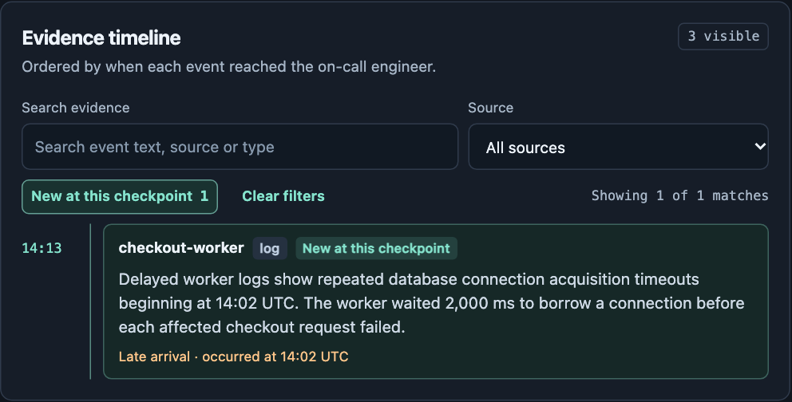
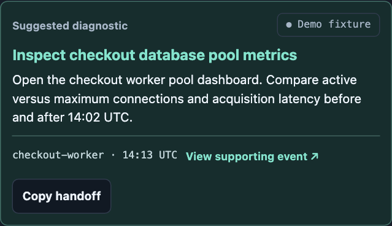

# Incident Replay

[](https://github.com/MrRobotop/incident-replay/actions/workflows/ci.yml)
[](.nvmrc)
[](LICENSE)
[](https://subq.ai/)
[](#1-run-the-demo)

Incident Replay is a self-hosted tool for incident response, on-call training, and SRE postmortems. Replay an outage using the alerts, deployments, and logs that were available at each checkpoint. Compare your next move with a diagnostic suggested by Subquadratic’s SubQ Snap, inspect the supporting event, and share the checkpoint with the next engineer.

[Run the demo](#1-run-the-demo) · [Add a SubQ key](#2-enable-live-evaluation) · [Import an incident](#3-replay-your-own-incident) · [How SubQ fits](#how-we-built-the-decision-workflow-with-subquadratic) · [Deploy](#deploy) · [Run tests](#development-and-tests)

## A checkout incident in three checkpoints

At **14:08 UTC**, an alert says checkout failures spiked. At **14:10**, the timeline receives a deployment record, so comparing the rollout with the failures is a reasonable next move. At **14:13**, a delayed worker log shows database connection pressure at **14:02**, before the frontend rollout. Inspecting the worker’s pool metrics now takes priority.



*Timeline panel, Demo fixture. Search, source, and new-event filters help you find the evidence that arrived at the current checkpoint.*



*Recommendation panel, Demo fixture. Open the supporting log or copy a handoff with the next step and a link to the evidence.*

## 1. Run the demo

Requires Git, Node.js 24, and npm. If you use nvm, run `nvm install` from the project folder to use the version in [`.nvmrc`](.nvmrc). You can also download the project with **Code → Download ZIP** and run the npm commands from the extracted folder.

```sh
git clone https://github.com/MrRobotop/incident-replay.git
cd incident-replay
npm ci
npm run dev
```

1. Open the app and select **Checkout errors rising**. [Local app](http://localhost:3000)
2. Choose a diagnostic if you want to make a prediction, then click **Reveal recommendation**. Advance through the checkpoints and use **New at this checkpoint** to find the delayed worker log.
3. Use **View supporting event** to inspect the original timeline entry. **Copy checkpoint link** opens the same point in the replay for someone who has access to the instance. **Copy handoff** adds the recommendation and links to its supporting event when one is available.

The demo includes 12 synthetic incidents and uses bundled decisions, so you can explore the workflow without a SubQ key.

To try the same replay in a terminal:

```sh
npm run replay -- --scenario checkout-pool-pressure --checkpoint worker-telemetry --mode demo
```

## 2. Enable live evaluation

Create a key and check that your account has credits. If `.env.local` already exists, edit that file directly. Otherwise, copy the template. [SubQ Console](https://console.subq.ai/)

```sh
cp .env.example .env.local
```

Edit **`.env.local`** in the project root next to `package.json` and set these values.

```dotenv
INCIDENT_REPLAY_MODE=live
SUBQ_API_KEY=your_actual_key
```

Stop the dev server with **Ctrl+C**, run `npm run dev` again, and refresh the page. The header should show **Live SubQ**. Select a checkpoint and click **Evaluate with SubQ**. The server sends the visible checkpoint context, and the key stays in its environment. Git ignores `.env.local`.

Run a live check from the CLI with the same configuration. Add `--json` to inspect the action and evidence IDs and the provider usage.

```sh
npm run replay -- --scenario checkout-pool-pressure --checkpoint worker-telemetry --mode live --json
```

| If you see… | Try this |
| --- | --- |
| **Reveal recommendation** | Confirm the file is named exactly `.env.local`, check `INCIDENT_REPLAY_MODE=live`, and restart. |
| **Key rejected** or **insufficient credits** | Check the key and account credits in the SubQ Console. |
| **Browser origin rejected** | Use `http://localhost:3000`, or set `INCIDENT_REPLAY_ORIGIN` to the exact origin you opened. |
| **Insufficient evidence** | Follow the suggested evidence-gathering step or advance the replay. |

## 3. Replay your own incident

Start with two sources from the same time window. An alert establishes the symptom, while logs or a deployment record can help you test a hypothesis.

| Source | Import option | What it adds |
| --- | --- | --- |
| Timestamped events | `--events FILE` | Alert, metric, trace, or runbook evidence in the [sample JSON format](examples/checkout-events.json). |
| Grafana Loki | `--loki FILE` | Log streams from an exported `query_range` response. [Loki API](https://grafana.com/docs/loki/latest/reference/loki-http-api/#query-logs-within-a-range-of-time) |
| GitHub Deployments | `--github FILE` | Deployment status history for a rollout. [GitHub API](https://docs.github.com/en/rest/deployments/statuses#list-deployment-statuses) |

Try the complete import flow with the bundled sample:

```sh
npm run import:incident -- --title "Checkout incident" --events examples/checkout-events.json
```

Add this line to `.env.local` and restart the app:

```dotenv
INCIDENT_REPLAY_IMPORT_DIR=private-incidents
```

Choose **Checkout incident** under **Imported incidents**. You can search the timeline and move through checkpoints locally. When importing your own data, review the normalized case before approving any SubQ request. The importer masks common credential patterns and email addresses, and additional sensitive fields can remain.

To evaluate imported evidence, run the instance in live mode, set `INCIDENT_REPLAY_ALLOW_IMPORTED_SUBQ=true`, and restart. At each checkpoint, review the evidence and confirm that it can be sent to SubQ. A shared checkpoint or evidence link requires access to the same instance. The link carries a checkpoint and event reference, while the app loads the timeline from the server. Subquadratic documents its retention policy and exceptions. [Import guide](docs/importing-incidents.md) · [SubQ data retention](https://docs.subq.ai/using-the-api/data-retention/)

## How we built the decision workflow with Subquadratic

Incident Replay starts with the question *Given the evidence that has arrived, what should I check next?* We used Subquadratic’s SubQ Snap to choose a concrete diagnostic and point to a supporting event. Its Decisions API accepts a set of choices and can evaluate a large body of context. That fits a replay because the useful clue may be an earlier alert, a delayed log, or a change record that only matters alongside another event. [Subquadratic](https://subq.ai/) · [Decisions API](https://docs.subq.ai/endpoints/decisions-api/)

1. **Assemble the checkpoint.** The server uses the time an event became available to decide whether to include it. An event can describe an earlier failure and still arrive later. The request contains up to 128 visible events within the app’s context budget.
2. **Ask two questions.** The server calls `POST /v1/systemone` with `subq-snap-1.2`. The `next_step` question offers read-only diagnostics and an insufficient-evidence option. The `supporting_event` question offers submitted event IDs and a no-evidence option. [Request and response example](docs/subq-integration.md#example-exchange)
3. **Validate and display.** The app checks that the returned action was offered and the selected event was submitted, then links to the original record for review. When the decision has insufficient evidence, the app shows what to gather next. In live mode it also shows how many events it sent, input token usage, and estimated cost. [Model and pricing](https://docs.subq.ai/using-the-api/models/)

Use imported incidents to walk a team through a past outage, compare what each person would have checked, or hand off the current point in the investigation. If you’re building your own integration with SubQ, the request builder and response validator show how to constrain model choices to actions and records your application can resolve. [Request builder](src/subq/contract.ts) · [SubQ API quickstart](https://docs.subq.ai/)

## Deploy

For a local production build:

```sh
npm run build
npm start
```

Or run a loopback-only Docker instance:

```sh
docker build -t incident-replay .
docker run --rm -p 127.0.0.1:3000:3000 incident-replay
```

Pass runtime environment settings with `--env-file .env.local` for a live container. Mount any private case directory read-only and use its container path for `INCIDENT_REPLAY_IMPORT_DIR`. Put a shared instance behind an authenticated TLS proxy and set `INCIDENT_REPLAY_ORIGIN` to the browser origin. Everyone with access to a private instance can see its configured library. [Deployment and limits](docs/architecture.md)

## Development and tests

```sh
npm run lint
npm run typecheck
npm test
npm run build
npx playwright install chromium --only-shell
npm run test:browser
```

Run the offline fixture benchmark without spending credits:

```sh
npm run eval -- --mode demo --split all
```

The live benchmark compares the latest signal with the full visible history and reports decision quality, latency, and estimated cost. It consumes SubQ credits. [Evaluation guide](docs/evaluation.md)

[Contributing](CONTRIBUTING.md) · [Security](SECURITY.md) · [SubQ integration](docs/subq-integration.md) · [Release checklist](docs/release.md)
